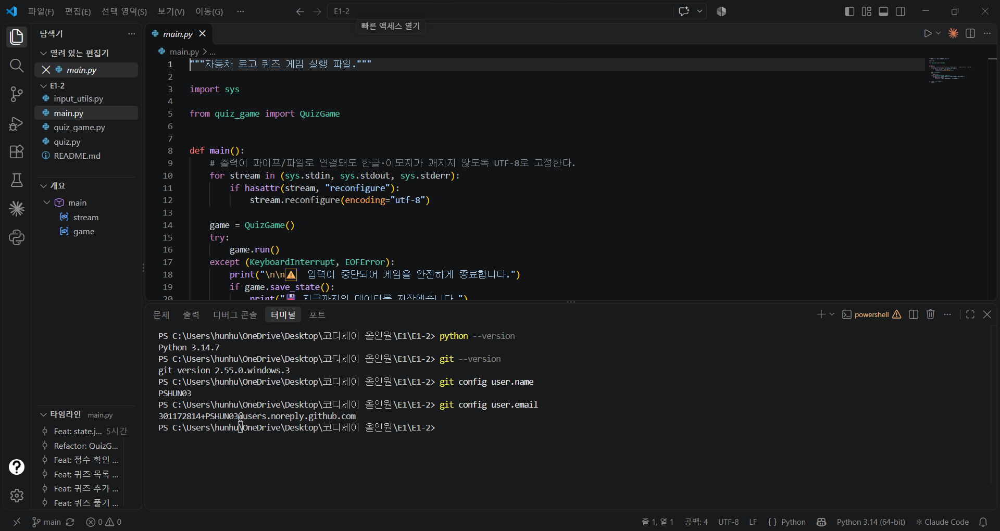
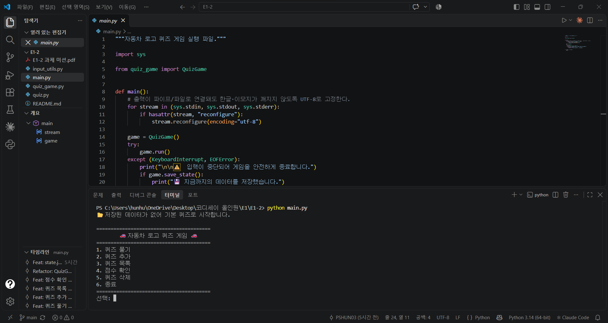
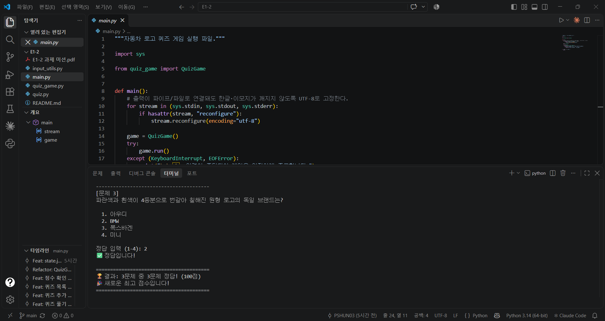
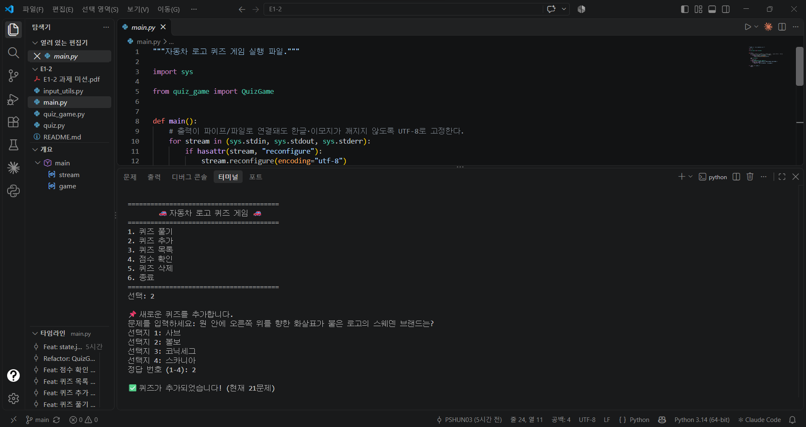
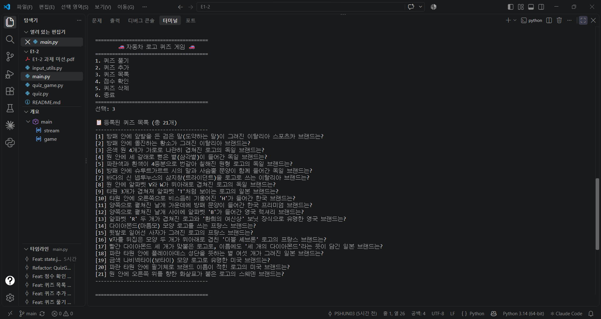
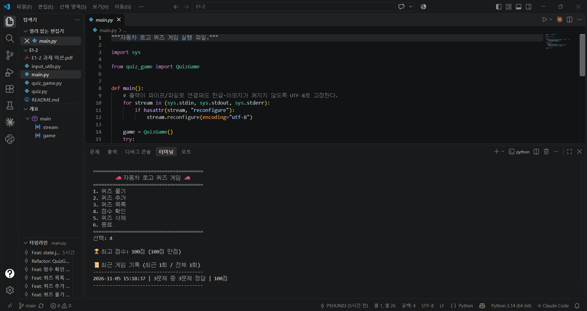
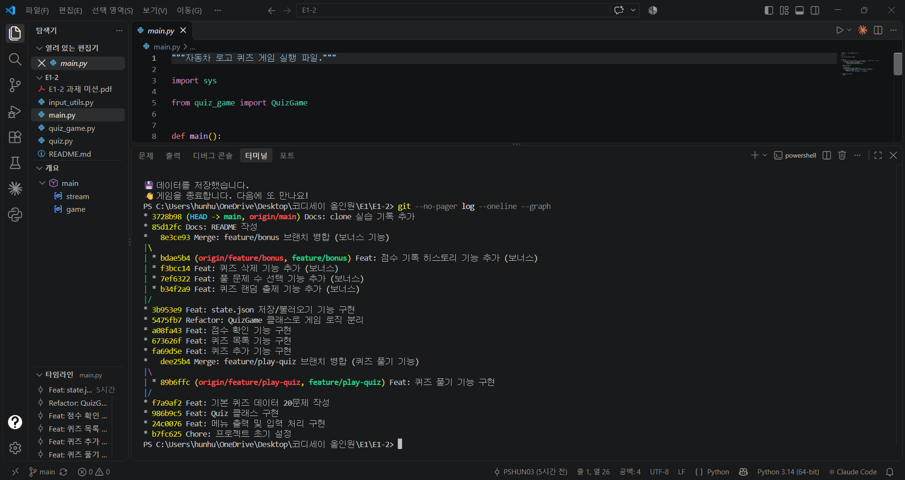

# 🚗 자동차 로고 퀴즈 게임

터미널에서 동작하는 Python 자동차 로고 퀴즈 게임입니다.
메뉴에서 번호를 골라 퀴즈를 풀고, 새 퀴즈를 등록하고, 최고 점수와 게임 기록을 확인할 수 있습니다.
추가한 퀴즈와 점수는 `state.json`에 저장되어 프로그램을 껐다 켜도 그대로 유지됩니다.

---

## 1. 프로젝트 개요

| 항목 | 내용 |
|---|---|
| 목표 | Python 기본 문법과 클래스로 동작하는 콘솔 프로그램을 처음부터 끝까지 완성하고, Git으로 개발 과정을 기능 단위로 기록한다. |
| 핵심 구조 | `Quiz`(퀴즈 한 문제) + `QuizGame`(게임 전체 관리) 2개 클래스로 역할 분리 |
| 데이터 영속성 | 퀴즈 목록, 최고 점수, 게임 기록을 프로젝트 루트의 `state.json`에 UTF-8로 저장 |
| 기본 데이터 | 자동차 로고 퀴즈 20문제 |
| 개발 환경 | Windows 11, Python 3.14 (3.10 이상 필요), 외부 라이브러리 없음 (표준 라이브러리만 사용) |

---

## 2. 퀴즈 주제와 선정 이유

**주제: 자동차 브랜드 로고 맞추기**

예전부터 자동차를 좋아했고, 로고만 보고 어느 브랜드인지 맞히는 퀴즈 자체가 재미있어서 이 주제를 골랐습니다.

자동차 로고는 단순한 그림이 아니라 브랜드의 출신과 역사가 담긴 상징이라, 문제를 만드는 과정 자체가 공부가 되었습니다.

- 포르쉐 로고에는 본사가 있는 슈투트가르트 시의 말과 옛 뷔르템베르크 왕국의 사슴뿔 문양이 들어 있습니다.
- 스바루의 별 여섯 개는 일본어로 '스바루'라고 부르는 플레이아데스 성단을 뜻합니다.
- 마세라티의 삼지창은 창업지인 볼로냐 광장의 넵투누스 동상에서 따왔습니다.

콘솔 프로그램은 이미지를 보여 줄 수 없습니다. 그래서 **로고의 생김새를 글로 묘사하고, 4개의 보기 중 브랜드를 고르는 방식**으로 문제를 구성했습니다. 눈으로 보던 정보를 텍스트 데이터로 바꿔 표현하는 방법을 고민해 볼 수 있었습니다.

---

## 3. 실행 방법

```bash
# 1) 저장소 복제
git clone https://github.com/PSHUN03/Codyssey-E1-2.git
cd Codyssey-E1-2

# 2) 실행 (Python 3.10 이상)
python main.py
```

> Windows에서 `python` 명령이 없다면 `py main.py`로 실행합니다.
> 별도 설치가 필요한 라이브러리는 없습니다.

첫 실행 시 `state.json`이 없으므로 기본 퀴즈 20문제로 시작하고, 같은 폴더에 `state.json`이 자동 생성됩니다.

---

## 4. 기능 목록

### 필수 기능

| 메뉴 | 기능 | 설명 |
|---|---|---|
| 1 | 퀴즈 풀기 | 저장된 퀴즈를 출제하고, 1~4번 중 정답을 입력받아 정답/오답을 알려 준다. 모든 문제를 풀면 결과와 100점 만점 점수를 보여 준다. |
| 2 | 퀴즈 추가 | 문제, 선택지 4개, 정답 번호를 입력받아 새 퀴즈를 등록하고 파일에 저장한다. |
| 3 | 퀴즈 목록 | 등록된 퀴즈의 번호와 문제를 목록으로 보여 준다. |
| 4 | 점수 확인 | 최고 점수(100점 만점)를 보여 준다. 퀴즈를 풀 때마다 최고 점수와 비교해 갱신한다. |
| 6 | 종료 | 데이터를 저장하고 프로그램을 종료한다. |

### 보너스 기능

| 기능 | 설명 |
|---|---|
| 랜덤 출제 | `random.sample`로 매 게임 문제 순서를 무작위로 섞는다. 원본 목록 순서는 유지한다. |
| 문제 수 선택 | 퀴즈 시작 전에 몇 문제를 풀지 고른다. (1 ~ 전체 문제 수) |
| 퀴즈 삭제 (메뉴 5) | 목록에서 번호를 고르고 y/n 확인 후 삭제한다. 0을 입력하면 취소한다. |
| 점수 기록 히스토리 | 게임마다 날짜/시간, 푼 문제 수, 정답 수, 점수를 저장하고, 점수 확인 메뉴에서 최근 5회 기록을 보여 준다. |

> 힌트 기능은 점수 계산 규칙(힌트 사용 시 차감)이 복잡해져 이번 범위에서 제외했습니다.

### 점수 계산 기준

- 점수 = `round(정답 수 / 푼 문제 수 × 100)` → **100점 만점**
- 최고 점수는 이번 점수가 기존 최고 점수보다 **높을 때만** 갱신한다.

---

## 5. 입력 및 예외 처리 기준

숫자를 입력받는 모든 곳(메뉴, 정답, 문제 수, 삭제 번호)에 같은 기준을 적용합니다. (`input_utils.py`)

| 상황 | 입력 예 | 처리 |
|---|---|---|
| 앞뒤 공백 | `  1  ` | 공백을 제거하고 `1`로 처리 |
| 숫자 변환 실패 | `abc` | `⚠️ 잘못된 입력입니다.` 안내 후 재입력 |
| 허용 범위 밖 | 메뉴 `9`, 정답 `0` | `⚠️ 범위를 벗어난 숫자입니다.` 안내 후 재입력 |
| 빈 입력 | (그냥 Enter) | `⚠️ 빈 입력입니다.` 안내 후 재입력 |
| 퀴즈 추가 시 빈 문제/선택지 | (그냥 Enter) | 안내 후 재입력 |
| 퀴즈 추가 시 중복 선택지 | 같은 보기 두 번 | `⚠️ 이미 입력한 선택지입니다.` 안내 후 재입력 |
| `Ctrl+C` / 입력 스트림 종료 | `KeyboardInterrupt`, `EOFError` | 안내 메시지 출력 → 지금까지의 데이터 저장 → 정상 종료 |
| `state.json` 없음 | 첫 실행 | 기본 퀴즈 20문제로 시작하고 파일 생성 |
| `state.json` 손상 | JSON 문법 오류, 잘못된 값 | 안내 메시지 출력 → `state.json.bak`으로 백업 → 기본 데이터로 복구 |
| 파일 읽기/쓰기 오류 | 권한 문제 등 | `try/except`로 처리하고 안내 메시지 출력 (프로그램은 계속 실행) |

---

## 6. 실행 화면 예시

### 메뉴

```text
📂 저장된 데이터를 불러왔습니다. (퀴즈 21개, 최고 점수 80점)

========================================
        🚗 자동차 로고 퀴즈 게임 🚗
========================================
1. 퀴즈 풀기
2. 퀴즈 추가
3. 퀴즈 목록
4. 점수 확인
5. 퀴즈 삭제
6. 종료
========================================
선택:
```

### 퀴즈 풀기

```text
선택: 1

몇 문제를 풀까요? (1-21): 5

📝 퀴즈를 시작합니다! (총 5문제, 랜덤 출제)

----------------------------------------
[문제 1]
양쪽으로 펼쳐진 날개 사이에 알파벳 'B'가 들어간 영국 럭셔리 브랜드는?

  1. 롤스로이스
  2. 재규어
  3. 벤틀리
  4. 애스턴 마틴

정답 입력 (1-4): 3
✅ 정답입니다!

----------------------------------------
[문제 2]
다이아몬드(마름모) 모양 로고를 쓰는 프랑스 브랜드는?

  1. 푸조
  2. 시트로엥
  3. 르노
  4. 부가티

정답 입력 (1-4): 1
❌ 오답입니다. 정답은 3번 '르노' 입니다.

... (중략) ...

========================================
🏆 결과: 5문제 중 4문제 정답! (80점)
🎉 새로운 최고 점수입니다!
========================================
```

### 퀴즈 추가

```text
선택: 2

📌 새로운 퀴즈를 추가합니다.
문제를 입력하세요: 원 안에 오른쪽 위를 향한 화살표가 붙은 로고의 스웨덴 브랜드는?
선택지 1: 사브
선택지 2: 볼보
선택지 3: 코닉세그
선택지 4: 스카니아
정답 번호 (1-4): 2

✅ 퀴즈가 추가되었습니다! (현재 21문제)
```

### 퀴즈 목록

```text
선택: 3

📋 등록된 퀴즈 목록 (총 21개)
----------------------------------------
[1] 방패 안에 앞발을 든 검은 말(도약하는 말)이 그려진 이탈리아 스포츠카 브랜드는?
[2] 방패 안에 돌진하는 황소가 그려진 이탈리아 브랜드는?
...
[21] 원 안에 오른쪽 위를 향한 화살표가 붙은 로고의 스웨덴 브랜드는?
----------------------------------------
```

### 점수 확인 (최고 점수 + 히스토리)

```text
선택: 4

🏆 최고 점수: 80점 (100점 만점)

📜 최근 게임 기록 (최근 2회 / 전체 2회)
----------------------------------------
2026-11-05 10:20:41 | 5문제 중 4문제 정답 | 80점
2026-11-05 10:16:11 | 3문제 중 0문제 정답 | 0점
----------------------------------------
```

### 잘못된 입력 처리

```text
선택: abc
⚠️  잘못된 입력입니다. 1-6 사이의 숫자를 입력하세요.
선택: 9
⚠️  범위를 벗어난 숫자입니다. 1-6 사이의 숫자를 입력하세요.
선택:
⚠️  빈 입력입니다. 1-6 사이의 숫자를 입력하세요.
```

### 손상된 state.json 복구

```text
⚠️  state.json이 손상되었거나 읽을 수 없습니다. (Expecting value: line 1 column 16 (char 15))
🗂️  손상된 파일은 state.json.bak(으)로 백업했습니다.
🔧 기본 퀴즈 데이터로 복구했습니다.
```

### Ctrl+C로 중단

```text
문제를 입력하세요: ^C

⚠️  입력이 중단되어 게임을 안전하게 종료합니다.
💾 지금까지의 데이터를 저장했습니다.
```

---

## 7. 파일 구조

```text
Codyssey-E1-2/
├── main.py              # 실행 진입점: QuizGame 실행, Ctrl+C/EOF 처리
├── quiz_game.py         # QuizGame 클래스: 메뉴, 게임 진행, 퀴즈 관리, 점수, 파일 저장/불러오기
├── quiz.py              # Quiz 클래스: 퀴즈 한 문제(문제/선택지/정답), 출력, 정답 확인, dict 변환
├── default_quizzes.py   # 기본 퀴즈 데이터 20문제
├── input_utils.py       # 공통 입력 처리 함수 (숫자/문자열/y·n)
├── docs/
│   └── screenshots/     # 실행 화면 스크린샷
├── .gitignore
├── README.md
└── state.json           # (실행 시 자동 생성, Git에는 올리지 않음)
```

### 클래스 설계

| 클래스 | 역할 | 주요 속성 | 주요 메서드 |
|---|---|---|---|
| `Quiz` | 퀴즈 한 문제 | `question`, `choices`(4개), `answer`(1~4) | `display()`, `is_correct()`, `correct_choice()`, `to_dict()`, `from_dict()` |
| `QuizGame` | 게임 전체 관리 | `quizzes`, `best_score`, `history`, `state_path` | `run()`, `show_menu()`, `play_quiz()`, `add_quiz()`, `list_quizzes()`, `show_score()`, `delete_quiz()`, `load_state()`, `save_state()` |

---

## 8. 데이터 파일 설명 (`state.json`)

### 경로와 역할

- **경로:** 프로젝트 루트의 `state.json`
  - 코드에서 `Path(__file__).resolve().parent / "state.json"`으로 경로를 정합니다. 그래서 다른 폴더에서 `python 경로/main.py`로 실행해도 항상 프로젝트 루트에 저장됩니다.
- **역할:** 퀴즈 목록, 최고 점수, 게임 기록을 저장하는 세이브 파일입니다. 프로그램을 종료하고 다시 실행해도 데이터가 유지되도록 합니다.
- **인코딩:** UTF-8 (`ensure_ascii=False`로 한글을 그대로 저장)
- **Git 관리:** 실행 중 계속 바뀌는 개인 데이터라 `.gitignore`로 제외했습니다. 저장소를 처음 clone한 사람은 첫 실행 때 기본 퀴즈로 자동 생성됩니다.

### 스키마

| 키 | 타입 | 설명 |
|---|---|---|
| `quizzes` | list | 퀴즈 목록 |
| `quizzes[].question` | str | 문제 |
| `quizzes[].choices` | list[str] | 선택지 4개 |
| `quizzes[].answer` | int | 정답 번호 (1~4) |
| `best_score` | int \| null | 최고 점수 (0~100, 100점 만점). 아직 풀지 않았으면 `null` |
| `history` | list | 게임 기록 (보너스). 키가 없는 이전 형식 파일은 빈 기록으로 처리 |
| `history[].played_at` | str | 게임한 날짜와 시간 (`YYYY-MM-DD HH:MM:SS`) |
| `history[].total` | int | 푼 문제 수 |
| `history[].correct` | int | 맞힌 문제 수 |
| `history[].score` | int | 점수 (100점 만점) |

### 예시

```json
{
  "quizzes": [
    {
      "question": "방패 안에 앞발을 든 검은 말(도약하는 말)이 그려진 이탈리아 스포츠카 브랜드는?",
      "choices": ["람보르기니", "페라리", "마세라티", "포르쉐"],
      "answer": 2
    }
  ],
  "best_score": 80,
  "history": [
    {
      "played_at": "2026-11-05 10:20:41",
      "total": 5,
      "correct": 4,
      "score": 80
    }
  ]
}
```

### 저장 시점과 안전장치

- **저장 시점:** 퀴즈 추가 직후, 퀴즈 삭제 직후, 퀴즈 풀기 완료 직후, 종료 선택 시, `Ctrl+C`/EOF로 중단될 때
- **임시 파일 교체 방식:** `state.json.tmp`에 먼저 쓴 다음 `os.replace`로 바꿔치기합니다. 저장 도중 프로그램이 멈춰도 기존 파일이 반쯤 쓰인 채 깨지지 않습니다.
- **불러올 때 검증 항목:** 최상위 타입, `quizzes` 목록, 선택지 4개, 정답 1~4 정수, `best_score` 0~100 정수 또는 null, `history` 형식
  - 하나라도 틀리면 손상된 파일로 판단합니다. `state.json.bak`으로 백업한 뒤 기본 데이터로 복구합니다.

---

## 9. Git 작업 흐름

### 브랜치 전략

```text
$ git log --oneline --graph   (README 작성 전 기준)
*   8e3ce93 Merge: feature/bonus 브랜치 병합 (보너스 기능)
|\
| * bdae5b4 Feat: 점수 기록 히스토리 기능 추가 (보너스)
| * f3bcc14 Feat: 퀴즈 삭제 기능 추가 (보너스)
| * 7ef6322 Feat: 풀 문제 수 선택 기능 추가 (보너스)
| * b34f2a9 Feat: 퀴즈 랜덤 출제 기능 추가 (보너스)
|/
* 3b953e9 Feat: state.json 저장/불러오기 기능 구현
* 5475fb7 Refactor: QuizGame 클래스로 게임 로직 분리
* a08fa43 Feat: 점수 확인 기능 구현
* 673626f Feat: 퀴즈 목록 기능 구현
* fa69d5e Feat: 퀴즈 추가 기능 구현
*   dee25b4 Merge: feature/play-quiz 브랜치 병합 (퀴즈 풀기 기능)
|\
| * 89b6ffc Feat: 퀴즈 풀기 기능 구현
|/
* f7a9af2 Feat: 기본 퀴즈 데이터 20문제 작성
* 986b9c5 Feat: Quiz 클래스 구현
* 24c0076 Feat: 메뉴 출력 및 입력 처리 구현
* b7fc625 Chore: 프로젝트 초기 설정
```

- `main`: 항상 실행 가능한 상태를 유지하는 기본 브랜치
- `feature/play-quiz`: 퀴즈 풀기 기능을 별도 브랜치에서 개발한 뒤 `main`에 병합
- `feature/bonus`: 보너스 기능 4개를 개발한 뒤 `main`에 병합
- 병합 기록이 그래프에 남도록 `git merge --no-ff`를 사용했습니다.

### 커밋 메시지 규칙

| 접두어 | 의미 | 예시 |
|---|---|---|
| `Feat` | 새 기능 | `Feat: 퀴즈 추가 기능 구현` |
| `Refactor` | 동작은 같고 구조만 개선 | `Refactor: QuizGame 클래스로 게임 로직 분리` |
| `Docs` | 문서 | `Docs: README 작성` |
| `Chore` | 설정, 기타 작업 | `Chore: 프로젝트 초기 설정` |
| `Merge` | 브랜치 병합 | `Merge: feature/play-quiz 브랜치 병합` |

### Git 기초 명령어 7종 사용 기록

| 명령어 | 사용한 곳 |
|---|---|
| `git init` | 프로젝트 폴더를 Git 저장소로 초기화 |
| `git add` | 기능별로 변경 파일을 스테이징 |
| `git commit` | 기능 단위 커밋 (10개 이상) |
| `git push` | GitHub 원격 저장소(`origin`)에 업로드 |
| `git checkout` | `checkout -b feature/play-quiz`, `checkout -b feature/bonus`, `checkout main` |
| `git clone` | 복제 실습: 저장소를 별도 폴더에 복제 |
| `git pull` | 복제 실습: 복제본에서 push한 변경을 원래 작업 폴더로 가져옴 |

### 저장소 복제(clone/pull) 실습

두 사람이 협업하는 상황을 한 컴퓨터에서 재현했습니다.

```bash
# 1) 원래 작업 폴더와 다른 위치에 저장소 복제
git clone https://github.com/PSHUN03/Codyssey-E1-2.git ../E1-2-clone
cd ../E1-2-clone

# 2) 복제본에서 README에 한 줄 추가 후 commit → push
git add README.md
git commit -m "Docs: clone 실습 기록 추가"
git push origin main

# 3) 원래 작업 폴더로 돌아와 변경 사항 가져오기
cd ../E1-2
git pull origin main

# 4) 반영 확인
git log --oneline -3
```

**실습 기록 (복제본에서 추가한 줄):**

- 2026-11-05: `E1-2-clone` 폴더에 clone한 복제본에서 이 줄을 추가하고 commit → push 했습니다. 원래 작업 폴더에서 `git pull`로 이 줄이 반영된 것을 확인했습니다.

---

## 10. 스크린샷

| 내용 | 파일 |
|---|---|
| 개발 환경 (VSCode, Python 버전, Git 설정) | `docs/screenshots/environment.png` |
| 메뉴 화면 | `docs/screenshots/menu.png` |
| 퀴즈 풀기 | `docs/screenshots/play.png` |
| 퀴즈 추가 | `docs/screenshots/add_quiz.png` |
| 퀴즈 목록 | `docs/screenshots/list.png` |
| 점수 확인 | `docs/screenshots/score.png` |
| `git log --oneline --graph` | `docs/screenshots/git_log.png` |

### 개발 환경 (VSCode, Python 버전, Git 설정)


### 메뉴 화면 (첫 실행: 기본 퀴즈로 시작)


### 퀴즈 풀기


### 퀴즈 추가


### 퀴즈 목록 (추가한 21번 퀴즈 포함)


### 점수 확인 (최고 점수 + 게임 기록)


### `git log --oneline --graph`


---

## 11. 구현하며 정리한 개념

| 개념 | 이 프로젝트에서 사용한 방식 |
|---|---|
| 변수와 자료형 | `int`(정답 번호, 점수), `str`(문제), `bool`(정답 여부), `list`(선택지, 퀴즈 목록), `dict`(JSON 저장 형식), `None`(아직 기록 없음) |
| 조건문 | 정답/오답 판정, 최고 점수 갱신 여부, 입력값 범위 검사 (`if/elif/else`) |
| 반복문 | `for`: 정해진 개수만큼 반복 (문제 출제, 목록 출력) / `while`: 올바른 입력이 들어올 때까지 반복 (메뉴, 입력 검증) |
| 함수 | `read_number(prompt, min_value, max_value)`처럼 매개변수로 동작을 바꾸고 반환값으로 결과 전달 |
| 클래스 | `Quiz`는 데이터와 그 데이터를 다루는 기능을 묶고, `QuizGame`은 게임 전체 흐름을 관리 |
| `__init__`과 `self` | `__init__`은 객체가 만들어질 때 속성을 초기화하고, `self`는 "지금 이 객체 자신"을 가리킴 |
| 파일 입출력 | `open(..., encoding="utf-8")`로 열고, `json.load`/`json.dump`로 읽고 쓰기 |
| JSON | 사람도 읽을 수 있고 Python의 `dict`/`list`와 바로 변환되는 텍스트 데이터 형식 |
| 예외 처리 | `try/except`로 숫자 변환 실패(`ValueError`), 파일 오류(`OSError`), 중단(`KeyboardInterrupt`, `EOFError`) 처리 |
| Git vs GitHub | Git은 내 컴퓨터에서 변경 이력을 관리하는 도구, GitHub는 그 이력을 원격에 올려 공유·협업하는 플랫폼 |
